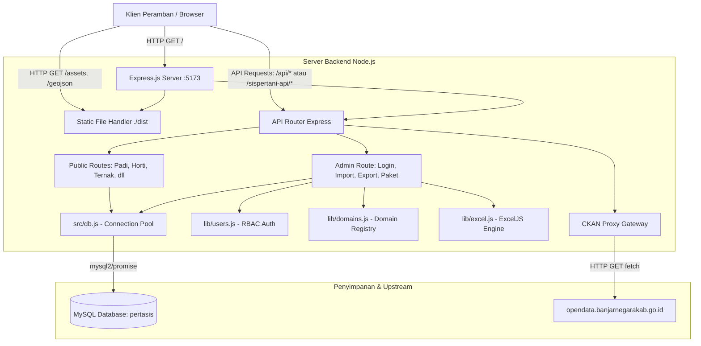
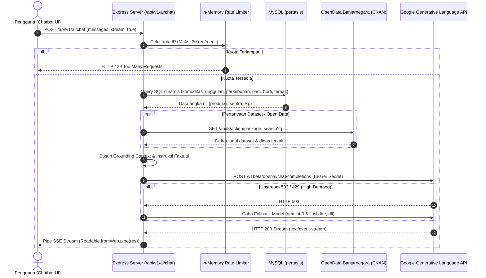
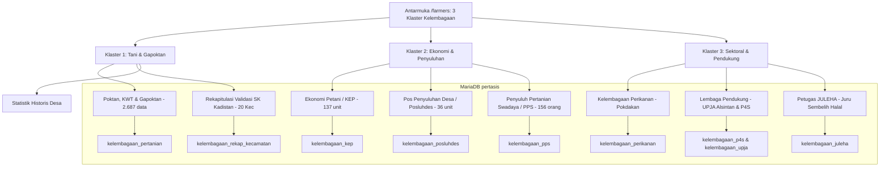
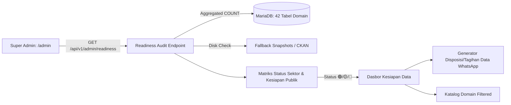

# Arsitektur Sistem SISPERTANI

Dokumen ini menjelaskan arsitektur perangkat lunak, aliran data makro, pola integrasi, dan batasan teknis sistem SISPERTANI Kabupaten Banjarnegara.

---

## 1. Diagram Aliran Data Makro

Sistem mengadopsi pola **Single-Unit Monolith (Micro-Monolith)** di mana server Node.js Express melayani API RESTful berorientasi data statistik dan sekaligus menyajikan antarmuka pengguna SPA (Single Page Application) serta berkas spasial GeoJSON statis:

---

## 2. Lapisan Presentasi & Frontend (Presentation Layer)

1. **Aplikasi Single-Page (SPA):**
   - Dibangun dengan Vite, React, dan Tailwind/CSS modern.
   - Dikompilasi ke direktori `./dist` dan disajikan langsung oleh Express melalui middleware `express.static(distRoot)`.
   - **SPA Fallback Routing:** Seluruh permintaan `GET` tanpa ekstensi berkas yang bukan merupakan rute `/api` atau `/sispertani-api` dialihkan secara otomatis ke `./dist/index.html`. Hal ini memastikan fitur reload/refresh halaman pada rute dalam (seperti `/desa/:kecamatan/:desa` atau `/bidang/:nama`) tetap berjalan tanpa galat 404. Normalisasi rute bertrailing slash (seperti `/kecamatan/` -> `/kecamatan` dan `/sebaran/` -> `/sebaran/pangan`) ditangani secara definitif pada layer HTTP server Express sebelum SPA fallback, mencegah potensi konflik scoring regex rute React Router v6 di sisi klien.

2. **Lapisan Spasial GIS (Geographic Information System & True-Lazy Loading):**
   - Menggunakan pustaka Leaflet dan MapLibre GL untuk merender peta interaktif dashboard eksekutif dan sebaran komoditas.
   - Peta dan data vektor disajikan dalam format GeoJSON statis dari direktori `./dist/` (`peta_desa_v3.geojson`, `peta_kecamatan.geojson`, `sawah.geojson`, `kebun.geojson`, `ladang.geojson`, `danau.geojson`, `sungai.geojson`, `jalan.geojson`, dll).
   - **Optimasi Geometri & Koordinat (ADR-051):** Seluruh berkas GeoJSON dioptimasi via `scripts/optimize_geojson.js` (`npm run geojson:optimize`) dengan pembulatan koordinat 6 desimal (~11 cm akurasi), 2D flattening (eliminasi elevasi Z `0`), serta pembersihan metadata shapefile mentah (`METADATA`, `SRS_ID`, dll), memangkas ukuran total dari 23,30 MB menjadi 13,72 MB (-41,1%).
   - **True-Lazy Layer Loading:** Bundel frontend (`pages-BdW-ZTL4.js`) mengimplementasikan pemuatan on-demand via event Leaflet `overlayadd`. Layer berat (Jaringan Jalan 5,5 MB, Sawah 1,1 MB, Kebun 1,8 MB, Ladang 1,1 MB) hanya diunduh saat pengguna mencentang toggle layer bersangkutan, memangkas transfer awal halaman sebesar 85,8% (~3,3 MB initial payload).
   - **Ketahanan Cache Browser:** Berkas `peta_desa_v3.geojson` yang terpangkas menjadi 2,48 MB kini muat aman dalam kuota 5 MB `localStorage` browser tanpa `QuotaExceededError`. Dilengkapi header HTTP `Cache-Control: public, max-age=86400, stale-while-revalidate=604800`.

3. **Arsitektur Aset Bersih & Ilustrasi Header Sektoral (ADR-052):**
   - Direktori `./dist/assets` dikelola secara bersih (*deterministic asset pruning*) hanya menyisakan berkas aktif terverifikasi (84 bundel JS aktif terhubung ke entry point `index-CI1XYnwk.js` dan CSS `index-DmHYJUQI.css`).
   - Seluruh 13 aset ilustrasi sektor domain disimpan secara eksklusif dan kanonikal di direktori `./dist/img/domain/` (`dashboard.png`, `prediction.png`, `horticulture.png`, `plantation.png`, `livestock.png`, `fisheries.png`, `food-security.png`, `supply-chain.png`, `price-volatility.png`, `farmers.png`, `economic-value.png`, `Irrigation512px.png`, `suitability.png`).
   - Berkas `dashboard.png` dioptimasi melalui kompresi Lanczos retina 512px, memangkas ukuran dari 1,06 MB menjadi 125 KB (-88,2%).
   - Seluruh gambar domain disajikan secara alami (*unboxed illustration*) tanpa kotak pembungkus/border/shadow artifisial, dengan proporsi `h-14 sm:h-16 w-auto object-contain` (`maxHeight: 60px`) sehingga tinggi seluruh header halaman seragam (~72–80px) tanpa pergeseran layout.
   - Tata letak antarmuka utama mengimplementasikan **Avatar Dropdown Interaktif** setinggi `72px`, merapikan tautan utilitas (Info, Panduan, Akses Portal Admin, dan Profil Akses) ke dalam wadah floating menu terpadu.

4. **Ketahanan Geometri Spasial Leaflet (ADR-053):**
   - Penanganan khusus untuk fitur spasial bertipe `GeometryCollection` pada peta desa (`dist/peta_desa_v3.geojson`).
   - Skrip optimasi GeoJSON (`scripts/optimize_geojson.js`) secara rekursif memproses seluruh sub-poligon dalam array `geometries` dengan presisi 6 desimal.
   - Bundel peta Leaflet (`pages-BdW-ZTL4.js`) dilengkapi *defensive guard* `(n.geometries ? n.geometries.length : 0)` untuk perlindungan fail-safe permanen dari kegagalan render peta.

5. **Penyelarasan Kanonikal & Unifikasi Tab Baku (ADR-054):**
   - **Sinkronisasi 36 Rute 100%:** Seluruh menu navigasi sidebar (`site-B5h-x_N5.js`) dan tag `<h1>` halaman diselaraskan ke nama kanonikal yang identik tanpa deviasi.
   - **Executive Segmented Pill Tabs:** Standar tunggal tab navigasi di seluruh halaman aplikasi (`flex flex-wrap items-center gap-1.5 p-1 rounded-lg border border-slate-200 bg-slate-100/90 shadow-sm w-fit`). Menghilangkan 5 variasi bentuk tab terfragmentasi dan seluruh inline hex hardcoded styling.
   - **Pembersihan Kartu Pembungkus Global `Ft`:** Komponen global `Ft` di `index-CI1XYnwk.js` dikonversi menjadi unboxed murni (`h-14 sm:h-16 w-auto object-contain max-h-[60px]`).
   - **Favicon Multi-Resolusi Terpadu:** Seluruh browser favicon (.ico dan .png 16×16 s/d 256×256) di-generate langsung dari aset master resmi `dist/logo.png`.

---

## 3. Lapisan Logika & Kontrol (Logic Layer)

1. **Dual-Mount Route Pattern:**
   - Untuk memfasilitasi penggunaan frontend baik secara langsung melalui port tunggal maupun di belakang reverse-proxy (seperti Nginx atau CloudPanel), seluruh endpoint API didaftarkan pada satu Express Router dan di-mount dua kali:
     - `/api/*` (jalur internal standar)
     - `/sispertani-api/*` (jalur prefix yang dipanggil frontend)
   - Pendekatan ini menghilangkan kerapuhan penulisan ulang URL (`req.url rewrite`) di middleware antar-versi Express.

2. **Manajemen Domain & Upsert Otomatis (Dynamic Domain Registry):**
   - Pustaka [`src/lib/domains.js`](file:///e:/Project/pertanian_main/src/lib/domains.js) mendaftarkan metadata **16 domain pertanian operasional** (mencakup KWT, LTT & Katam, dan 11 sheet Perikanan dengan dropdown validasi).
   - **Prinsip Single Source of Truth & Anti-Over-Engineering (ADR-009):** Komoditas Unggulan bukanlah berkas yang di-upload terpisah oleh dinas, melainkan dikalkulasi secara otomatis oleh server dari data produksi primer lapangan (padi, palawija, hortikultura, perkebunan, peternakan, 10 jenis ikan). Form upload `komoditas-unggulan` ditiadakan dari Admin Dasbor untuk mengeliminasi beban input ganda dan memastikan konsistensi angka 100%.
   - Kolom untuk template Excel dibaca secara dinamis dari `information_schema.columns` MySQL saat runtime, menjamin template Excel selalu sinkron 100% dengan skema database tanpa perlu migrasi kode ganda.
   - Menggunakan *natural key* unik per sheet (misal: kombinasi `kecamatan`, `tahun`, `komoditas`) untuk melakukan operasi `INSERT ... ON DUPLICATE KEY UPDATE` saat proses impor Excel berlangsung. Ekspor data menyertakan kolom `Sumber Data` untuk keterlacakan audit (*traceability*).

3. **Gateway Asisten AI & Hybrid Resilient RAG Engine (ADR-060):**
   - Modul [`src/routes/ai.js`](file:///d:/Project/pertanian_main/src/routes/ai.js) melayani Chatbot Si Pertani secara aman dari server-side, mengisolasi token `GEMINI_API_KEY` dari klien.
   - Dilengkapi **In-Memory Sliding Rate Limiter** (30 request/menit), **Multi-Model Failover Chain** (`gemini-3.5-flash-lite`, `gemini-flash-lite-latest`, `gemini-flash-latest`, `gemini-3.5-flash`, `gemini-3.8-flash`), dan **Dynamic RAG** yang menarik data riil basis data `pertasis` dan portal CKAN secara instan.
   - **Graceful Local Fallback & Rule-Based NLG:** Jika upstream AI offline, kuota limit, atau tanpa API key, sistem mengeksekusi sintesis bahasa alami via [`src/lib/ai-nlg.js`](file:///d:/Project/pertanian_main/src/lib/ai-nlg.js) dan modul pengetahuan pertanian daerah via [`src/lib/ai-offline-kb.js`](file:///d:/Project/pertanian_main/src/lib/ai-offline-kb.js). Dilengkapi streaming Server-Sent Events (SSE) dengan micro-chunk pacing generator untuk efek pengetikan halus (*smooth typing pacing*).

4. **Autentikasi & RBAC (Role-Based Access Control) Multi-Bidang (ADR-061):**
   - Modul [`src/lib/users.js`](file:///d:/Project/pertanian_main/src/lib/users.js) membatasi akses berdasarkan 5 bidang teknis dinas (Tanaman Pangan, Hortikultura & Perkebunan, Peternakan, Perikanan, Ketahanan Pangan) serta Administrator Pusat (ADR-061).
   - Menggunakan in-memory Bearer token dengan masa kedaluwarsa 12 jam.
   - Keamanan login diperkuat dengan `crypto.timingSafeEqual` untuk mencegah serangan *timing attack* dan pembatasan laju (rate limiting) maksimal 5 kali kegagalan per 15 menit per alamat IP.

5. **Proksi CKAN Gateway:**
   - Menyediakan endpoint `/api/3/*` yang meneruskan kueri ke portal Open Data resmi Kabupaten Banjarnegara (`https://opendata.banjarnegarakab.go.id`).
   - Menyediakan header cache `public, max-age=300` untuk mengurangi beban upstream dan memastikan katalog dataset tetap dapat diakses dari origin aplikasi yang sama tanpa kendala CORS.

6. **Lapisan Keamanan & Proteksi Berkas Sensitif (Security Guard):**
   - Middleware Express secara tegas memblokir akses publik (HTTP 403 Forbidden) ke berkas berekstensi sensitif (`.sql`, `.env`, `.bak`, `.sh`, `.bash`, `.yml`, `.config`) serta direktori tersembunyi.
   - Berkas migrasi dan dump basis data diisolasi ke direktori `database/` di luar web root statis `./dist` untuk mencegah kebocoran data.

---

## 4. Lapisan Basis Data (Persistence Layer)

- Menggunakan **MySQL/MariaDB** dengan nama database `pertasis`.
- Koneksi diatur menggunakan pool lazy-loaded pada [`src/db.js`](file:///e:/Project/pertanian_main/src/db.js) dengan `connectionLimit: 10`.
- Opsi `decimalNumbers: true` diaktifkan untuk memastikan nilai numerik presisi (seperti tonase panen dan persentase luas) dikembalikan dalam format tipe data `number` JavaScript asli, bukan `string`, menjaga integritas JSON dan grafik frontend.
- Opsi `dateStrings: true` mencegah pergeseran zona waktu yang tidak diinginkan pada format tanggal laporan.

---

## 5. Arsitektur Analitik Sektor & Zero Dummy Data

1. **Agregasi Dinamis Berbasis Waktu & Sektor:**
   - Endpoint `GET /api/v1/ekonomi/sektor-ringkasan` dan `GET /api/v1/komoditas-unggulan` menghitung ranking komoditas utama (ranking #1 volume panen) dan estimasi valuasi ekonomi secara langsung dari tabel basis data MySQL (`komoditas_unggulan` dan `nilai_ekonomi_tahunan`).
   - Setiap bidang (Tanaman Pangan, Hortikultura, Perkebunan, Peternakan, Perikanan) memiliki partisi data independen yang mencerminkan hasil input dinamis admin Sistertan dan sinkronisasi Open Data.

2. **Kepatuhan Zero Dummy Data (Zero Dummy Data Law):**
   - Sistem dirancang **tanpa data tiruan fiktif**:
     - Komoditas dengan volume produksi `0` otomatis dikecualikan dari pemeringkatan unggulan dan kalkulasi ekonomi.
     - Tahun yang belum memiliki catatan produksi mengembalikan status `empty` dan `totalNilaiEkonomiRp: 0` transparan.
     - Klien merender kartu status netral yang ramah pengguna alih-alih menampilkan varietas atau angka buatan.

3. **Integrasi Komponen & Submenu Navigasi Ganda:**
   - **Tingkat Halaman Sektor:** Widget `SectorEconomicWidget` tertanam reaktif pada 5 halaman produksi utama (`/food-crops`, `/horticulture`, `/plantation`, `/livestock`, `/fisheries`) mengikuti filter tahun aktif.
   - **Tingkat Navigasi Sidebar:** Setiap bidang dilengkapi submenu terstruktur:
     - `Komoditas Unggulan`: rute `/komoditas-unggulan/:bidang` untuk rincian varietas, luas, dan sentra komoditas.
     - `Nilai Ekonomi`: rute `/nilai-ekonomi/:bidang` untuk analisis valuasi finansial per komoditas. Khusus sektor peternakan (`/nilai-ekonomi/peternakan`), menyajikan 4 tab mandiri: *Nilai Ekonomi Ternak*, *UMKM Pakan Ternak*, *Toko Peternakan & Poultry Shop*, dan *Unit Usaha Ber-NKV*.
     - `Populasi Ternak`: rute `/livestock` memfokuskan murni pada populasi ternak hidup, indikator ternak dijual hidup, dan rumpun khas Domba Batur.
     - `Produksi & Hasil Ikutan`: rute `/peternakan/susu-kulit` memisahkan produksi utama (daging, telur, susu) dan hasil ikutan (kulit sapi, kerbau, kambing, domba, kelinci, wol batur, tulang & tanduk) terpilah per spesies tanpa kategori campuran, dilengkapi modul Simulasi Lahan HPT (Hijauan Pakan Ternak) dan filter *Strict Zero-Empty* (baris bernilai 0 difilter out).
   - **Manajemen Dasbor Admin Peternakan:** Didukung template Excel 10 sheet lengkap berpanduan (memuat isian wilayah, tahun, bulan, jenis, jumlah/banyaknya, satuan, dan status) serta endpoint entry cepat `POST /api/v1/peternakan/entry` untuk pengisian langsung bagian yang masih kosong.

---

## 6. Arsitektur AI Gateway & Dynamic Live RAG (Si Pertani)

1. **Isolasi Kredensial Mutlak:** API Key Google Gemini (`GEMINI_API_KEY`) hanya dibaca melalui `process.env` di backend, tidak pernah terekspos di paket statis frontend bundle (`dist/assets`).
2. **Proteksi Anti-Eksploitasi:** In-memory sliding rate limiter membatasi 30 panggilan per menit per alamat IP guna mencegah pengurasan kuota token oleh pihak ketiga.
3. **Dynamic Year-Aware Grounding & Cross-Year Retrievability (ADR-035):**
   - Server mengekstrak tahun pertanyaan pengguna secara regex `\b(201\d|202\d)\b`. Kueri SQL secara adaptif menyaring data tahun yang tepat (misalnya Salak 2023 di Kalibening: 83.181 Ton vs 2024: 80.880 Ton; Kopi Robusta 2024: 2.167 Ton di Karangkobar & Kalibening).
   - Menghapus pembatasan `ORDER BY tahun DESC LIMIT 8` yang sebelumnya menenggelamkan data tahun-tahun sebelumnya.
4. **Eliminasi Data Dummy & Filter Sektoral Khusus:**
   - Menyaring data dummy 0 Ton dari tabel `komoditas_unggulan` dengan klausa `total_produksi > 0 AND is_unggulan = 1`.
   - Mengintegrasikan kelompok Tanaman Hias (`kelompok = 'tanaman_hias'` di `horti_produksi`), Ikan Hias (`ikan_hias`), Tanaman Pangan (Wortel Dieng/Batur ~48.000 Ton), serta penegasan bahwa Banjarnegara bukan sentra Kelapa Sawit (0 Ton) dan bukan produsen dominan Bawang Merah (0,33 Ton).
   - Menyediakan query kelembagaan KWT per kecamatan dan desa sesuai arah pengurutan (*paling sedikit / paling banyak*).
5. **Standalone Offline Python Assistant (`scripts/offline_rag.py`):**
   - Mesin RAG mandiri berbasis Python (`pymysql`) tanpa ketergantungan framework Node.js maupun koneksi internet/API Key eksternal.
   - Dapat dioperasikan sebagai CLI satu baris (`npm run rag:offline "<query>"`), mode interaktif REPL, atau diimpor sebagai modul Python backend.
6. **Resilience & High Availability:** Orkestrasi fallback multi-model (`gemini-flash-lite-latest` -> `gemini-3.5-flash-lite` -> `gemini-3.6-flash` -> `gemini-3.8-flash`) menjamin layanan asisten tetap berjalan lancar tanpa terganggu lonjakan beban (*high demand*) pada model tertentu.

---

## 7. Arsitektur Modul Direktori Kelembagaan Terpadu (ADR-023 & ADR-024)

Modul Kelembagaan Pertanian Kabupaten Banjarnegara (`/farmers`) mengadopsi arsitektur hierarkis 2-tingkat (Sistem 3 Klaster) yang menghubungkan data resmi SIMLUHTAN, Kelembagaan Ekonomi, Ketenagaan Penyuluhan, dan Lembaga Pendukung Khusus:

1. **Pemisahan Klaster Navigasi:** Menata 8 entitas data agar terbebas dari *tab overload*, memudahkan aparatur dan masyarakat memilih klaster binaan utama (SIMLUHTAN), usaha & penyuluhan, atau pendukung sektoral.
2. **Paginasi Dinamis Client-Side Universal:** Setiap tab data disajikan dengan paginasi instan (25, 50, atau 100 baris per halaman) untuk memastikan kecepatan render DOM di perangkat laptop standar (1366×768) dan seluler.
3. **Pipeline Impor/Ekspor Mandiri Admin:** Terhubung ke sistem template Excel admin melalui domain `kelembagaan-pertanian` dan `kelembagaan-pendukung` di `src/lib/domains.js`, memungkinkan pembaruan data secara berkala oleh operator dinas tanpa intervensi kode.

---

## 8. Arsitektur Pemantauan Kesiapan Data Super Admin (Data Readiness Radar — ADR-026)

Untuk mendukung koordinasi pengumpulan data sektoral (Walidata Sektoral), antarmuka Super Admin dilengkapi modul audit kesiapan data yang memetakan status data database per bidang terhadap kebutuhan tampilan frontend:

1. **Non-Over-Engineered (Zero New Tables):** Tidak membuat skema database baru; audit dihitung langsung via kueri agregat `COUNT(*)` tabel-tabel operasional yang terdaftar di `DOMAINS` secara efisien (< 50ms).
2. **Tri-State Status Classification:**
   - 🟢 **Mandiri (Lokal DB):** Data definitif terisi di database, view publik aman.
   - 🟡 **Penyangga (Fallback Disk/CKAN):** View publik aktif tapi membaca snapshot cadangan, memerlukan pembaruan resmi.
   - 🔴 **Belum Tersedia (0 Baris):** Tabel kosong, prioritas tagihan data ke admin bidang teknis.
3. **Actionable Governance:** Menyediakan tombol 1-klik untuk menyalin rincian format tagihan data ke clipboard untuk komunikasi antar-bidang dinas (WhatsApp/disposisi) serta tautan langsung ke filter unduh template Excel.

